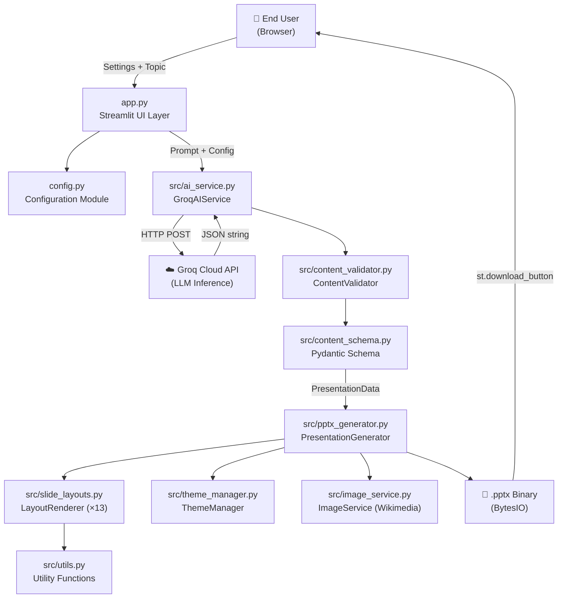
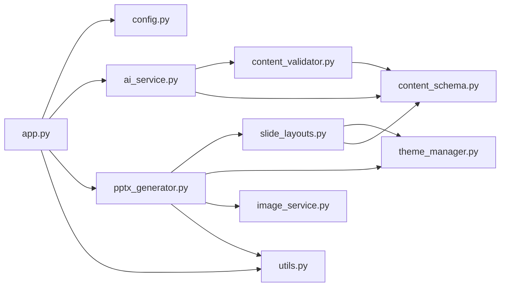
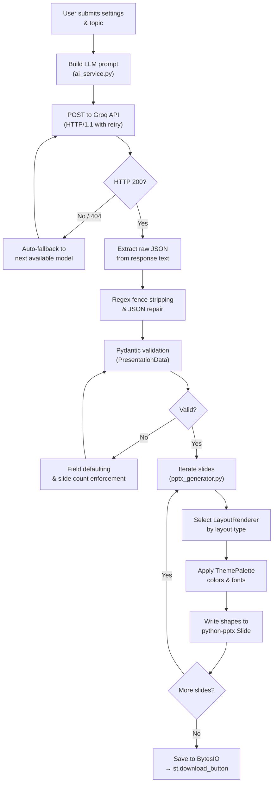
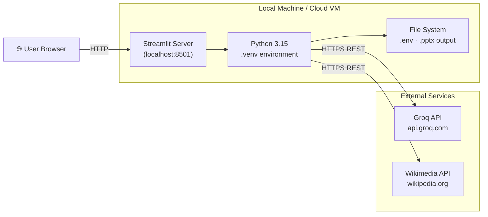

# System Architecture Diagrams

## Figure 1 — High-Level System Architecture

---

## Figure 2 — Module Dependency Graph

---

## Figure 3 — Presentation Generation Pipeline

---

## Figure 4 — Deployment Architecture

