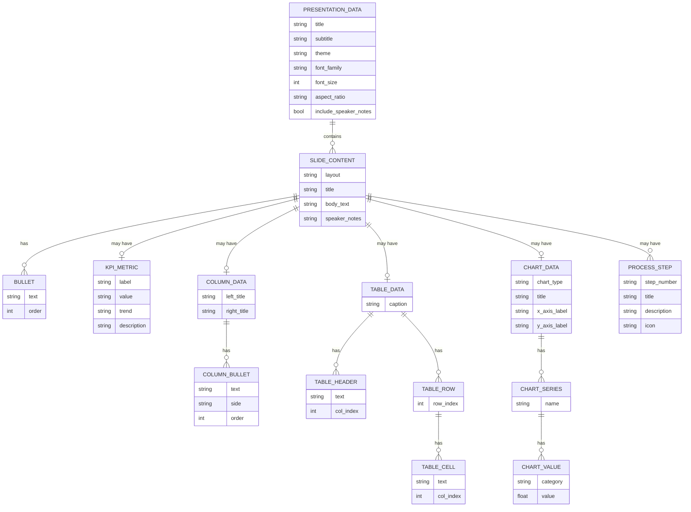
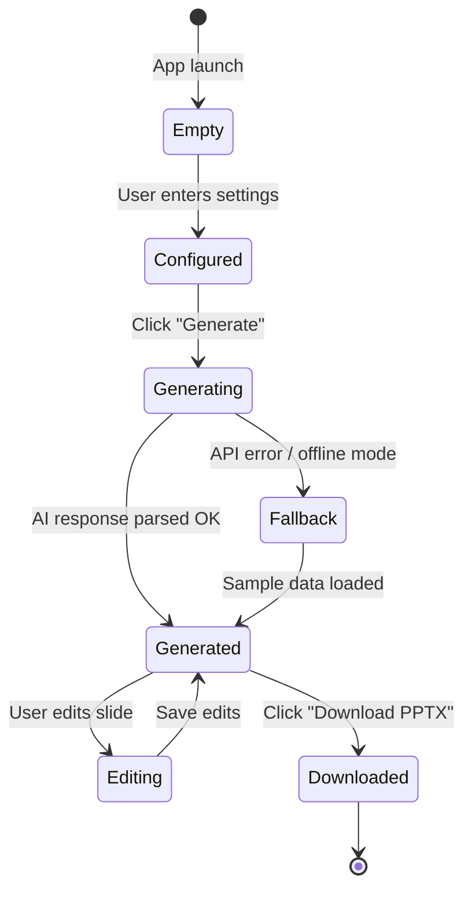

# Entity Relationship Diagram

> **Note**: The AI PPT Generator uses no relational database. All data is held
> in-memory via Pydantic models during a single session. The following ER diagram
> represents the **logical data model** derived from the Pydantic schema in
> `src/content_schema.py`.

## Figure 13 — Logical Data Model (Pydantic Schema as ER)

---

## Data Lifecycle

