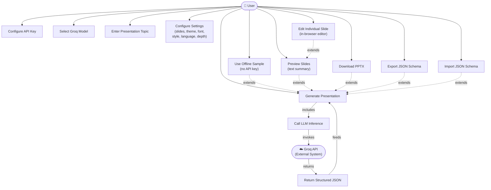

# UML Use Case Diagram

## Figure 11 — System Use Cases

---

## Figure 12 — Actor Responsibilities

| Actor | Role | Interactions |
|---|---|---|
| **User** | End user operating the web UI | Configures settings, triggers generation, downloads output |
| **Groq Cloud API** | External LLM inference service | Receives prompt, returns structured JSON |
| **Wikimedia API** | External image source (optional / fallback) | Returns image URLs for `image_text` layout |
| **Streamlit Runtime** | Web server framework | Renders UI components, manages session state |

